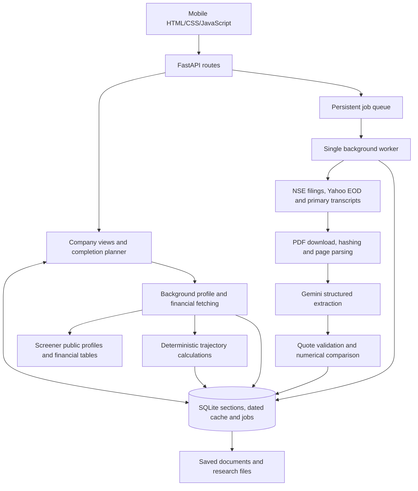

# FINN — Financial Investment Agent

FINN is a mobile-first investment intelligence prototype for the **ENAM Holdings AI Engineer Build Challenge**. It combines a selective portfolio digest with on-demand company research, focusing on what management promised and what the company delivered.

FastAPI serves the responsive interface and API. Saved company views load from local storage; PDF processing and Gemini extraction run in the background.

**Running demo:** [Open FINN on this computer](http://127.0.0.1:8000/) · [Open FINN on a phone on the same Wi-Fi](http://172.23.70.196:8000/). The LAN address was verified on 1 November 2026 and can change; see [Start the app](#start-the-app). These local links require the server to be running; a public deployment URL has not been configured.

## Feature overview

### Push Digest

- Covers the **35 NSE companies** in [config/portfolio.json](config/portfolio.json).
- Shows a rolling 24-hour filing digest, with longer windows and category filters.
- Flags EOD price moves of **at least ±3%** and volume **strictly above 2× the prior 20-session average**. Thresholds are configurable through Preferences.
- Classifies announcements into the 17 reference categories. Results, management changes, M&A, litigation and capital raises receive high priority; routine filings remain collapsed.
- Results cards show Revenue, EBITDA, PBT and PAT with available QoQ/YoY deltas and source labels. Management changes show person, role and action when extractable.
- Each card links directly to that company's Pull Deep Dive.

The official coverage universe is:

```text
20MICRONS, APOLLOHOSP, ASIANPAINT, BAJFINANCE, BHARTIARTL,
BSE, CAMS, COFORGE, DIXON, DMART, HAL, HAVELLS, HDFCBANK,
HINDUNILVR, ICICIBANK, INFY, KAYNES, LT, MARUTI, NTPC,
PERSISTENT, POLYCAB, RELIANCE, SEDEMAC, SIEMENS, SRF,
SUNPHARMA, TATACAP, TATAMOTORS, TCS, TITAN, TRENT,
ULTRACEMCO, VBL, ZOMATO
```

“Push” currently means an in-app attention feed refreshed from fetched data. Native notifications and scheduled refreshes are outside this prototype.

### Pull Deep Dive

Search by NSE ticker or company name using local suggestions and recent searches. The mobile section order is:

1. **Business snapshot:** a concise sourced description, products/brands and available segment mix from the public company profile. This section uses neither transcripts nor Gemini.
2. **Financial snapshot:** standardized quarterly financials with labeled sources and calculated values.
3. **5-year trajectory:** completed financial years with revenue in ₹ crore, revenue YoY growth, EBITDA margin and PAT, plus revenue/PAT CAGR. Calculations run in code.
4. **Narrative vs. Numbers:** management targets compared with compatible reported actuals. Clear historical comparisons show **Met** or **Missed**; future targets appear under **Active Guidance**. Vague or unmatched statements stay in an expandable section.

Opening a company through search or a digest card automatically fills missing sections. Existing sections remain visible while missing data loads. Transcript research runs as a background job with processing stages and an elapsed timer; the narrative section updates when it finishes. Saved research can be refreshed through **Update analysis**.

Quotes link to original documents and saved page evidence. Missing evidence never becomes an invented result or verdict.

## Architecture



### Technology stack

| Layer | Implementation |
|---|---|
| Interface | Responsive HTML/CSS and browser JavaScript modules; no frontend build or CDN |
| API | Python 3.12, FastAPI, Uvicorn and Pydantic |
| Sources and parsing | HTTPX, Beautiful Soup, yfinance, pandas and pypdf |
| Model | Google Gen AI SDK; configured default `gemini-3.5-flash-lite` |
| Persistence | SQLite, local document files and content-addressed extraction caches |
| Background work | Persistent SQLite jobs consumed by one worker |

Gemini handles structured extraction from evidence. Business descriptions, financial tables, growth calculations, market thresholds and numerical verdicts do not require model generation. There is no OpenAI dependency or automatic model fallback. Exact versions are pinned in [requirements.txt](requirements.txt).

### Data flow and caching

1. The UI reads the saved company view without downloading PDFs or calling a model.
2. A completion request fills missing profile/financial data independently of transcript research. Trajectory values are calculated from annual financial data.
3. Missing narrative research enters the persistent queue. The worker discovers original transcripts, downloads bounded documents, parses pages and requests structured extraction within a model-call budget.
4. Validators check quotes against saved page text. Comparison code requires compatible periods, metrics, reporting bases, currencies and scopes before assigning a verdict.
5. The UI polls progress and reloads saved sections when results change. Duplicate active requests reuse the existing job.

Section history is keyed by **ticker and date**, with latest aliases for fast reads. All 35 coverage companies are pinned against eviction. Ad-hoc company caches retain the **50 most recently searched companies**; background polling does not change that order. Immutable source PDF archives and provider usage logs are retained separately from this limit.

Source listings have separate freshness windows: discovery six hours, document URLs one day, prices one hour and filings fifteen minutes. Saved data keeps its original timestamps; a cached response does not imply live market data. Unchanged document hashes and extraction chunks reuse saved model output.

### Project layout

| Path | Responsibility |
|---|---|
| `web/` | Mobile interface, search, cards, progress polling and styles |
| `finn/api/` | UI delivery, company/digest endpoints, jobs and evidence access |
| `finn/services/` | View composition, section completion, business profiles and trajectory |
| `finn/sources/` | NSE directory/announcements, profiles/financials, EOD and document discovery |
| `finn/documents/` | Bounded downloads, hashing, page-preserving PDF parsing and chunking |
| `finn/extraction/`, `finn/models/` | Structured extraction, Gemini access, budgets and usage logging |
| `finn/analysis/`, `finn/signals/` | Guidance matching, verdicts, filing classification and market triggers |
| `finn/storage/`, `finn/jobs/` | SQLite, retention, deployment seeding, jobs and worker progress |
| `config/portfolio.json` | Coverage list and explicit source-symbol mappings |
| `scripts/`, `tests/` | Server, warming, audits, pipeline commands and checks |
| `data/` | Bundled pre-warmed database, documents and saved research |

## Local setup

Use **Python 3.12**. Run these commands from the repository root in PowerShell:

```powershell
python -m venv .venv
.\.venv\Scripts\python -m pip install -r requirements.txt
Copy-Item .env.example .env
```

For an existing checkout, reuse `.venv` and preserve your existing `.env`.

Edit `.env` locally:

```dotenv
GEMINI_API_KEY=your_gemini_api_key
GEMINI_MODEL=gemini-3.5-flash-lite
```

Saved research works without a key. New transcript analysis requires a valid Gemini key and access to the configured model; source fetching requires network access. Free quota depends on the provider/account. Never commit `.env` or credentials.

Create a key in [Google AI Studio](https://aistudio.google.com/app/apikey) and check its project permissions, model access and quota. Process environment variables take precedence over `.env`. `GOOGLE_API_KEY` is accepted when `GEMINI_API_KEY` is absent; prefer `GEMINI_API_KEY` consistently. The key stays on the backend.

```powershell
# Local environment checks.
.\.venv\Scripts\python -m scripts.check_environment

# Optional source and model-authentication checks.
.\.venv\Scripts\python -m scripts.check_environment --live

# Optional tiny generation request; may consume provider quota.
.\.venv\Scripts\python -m scripts.check_environment --live --generate
```

The live check verifies authentication/model-list access; only the generation check verifies a basic generation request. A missing key reports a skip. For 401/403 errors, check key validity and project restrictions; for 404, check model access; for 429, reduce requests or wait for quota renewal. No paid-model fallback is enabled. Diagnostics omit keys and API response bodies.

| Optional environment variable | Default / purpose |
|---|---|
| `FINN_DATA_DIR` | `data/` under the repository; override for a persistent volume |
| `FINN_MAX_MODEL_CALLS` | `6`; per-run call cap, including API-submitted research |
| `FINN_HTTP_TIMEOUT` | `30` seconds |
| `FINN_MAX_PDF_MB` | `30`; maximum document download size |
| `FINN_CHUNK_CHARS` | `18000`; extraction chunk size |
| `HOST`, `PORT` | `127.0.0.1`, `8000`; server environment defaults, overridden by CLI flags |

The Python settings above can be configured through `.env` or process variables. `HOST` and `PORT` are read from the process environment by the server launcher.

### Start the app

```powershell
.\.venv\Scripts\python -m scripts.serve --host 0.0.0.0 --port 8000
```

Open [FINN](http://127.0.0.1:8000/) or the [API reference](http://127.0.0.1:8000/docs). This starts the UI, API and **one embedded worker**. Do not run a second worker against the same database. No Node runtime is needed to run the app.

For phone testing, connect to the same Wi-Fi and open `http://<computer-LAN-IP>:8000/`. Find the computer's IPv4 address with `ipconfig`; allow Python through the Windows firewall on your private network if prompted. `127.0.0.1` on a phone refers to the phone itself, so use the computer's LAN address. That address can change after reconnecting.

### Mobile demo walkthrough

1. Open Push Digest and inspect the summary ribbon, filters and collapsed routine filings. Preferences beside Refresh opens the alert settings.
2. Tap a card's **Deep dive** button; confirm it opens that company's Pull view. Search for **DMART** and **INFY** and verify the section order: business, financials, trajectory, narrative.
3. Inspect historical **Met/Missed** comparisons where supported, separate active guidance and expandable unmatched statements. Open a citation to inspect the saved PDF page and original source link.
4. Open a new NSE ticker to check progressive section loading and automatic narrative research. An elapsed timer and stages appear while analysis runs; there is no remaining-time estimate. Source availability and Gemini quota determine completion.
5. Switch tabs or reload during analysis; reconnect to the saved job without submitting duplicate research. Recent searches remain in this browser. Tap the FINN logo to restore the default digest and scroll to the top.

### Bundled data and refresh

The repository includes the pre-warmed `data/finn.sqlite3` and supporting evidence. Cache warming is optional for an ordinary demo startup.

The recorded audit has **35/35 profiles, financial snapshots and five-year matrices**, plus **34 saved narrative reports**. TRENT has an explicit unavailable-primary-transcript record. A saved report can still have partial coverage or no comparable guidance. See [docs/coverage.md](docs/coverage.md) for per-company results and timings.

To fill missing coverage data and queue transcript research, keep the server running and use another terminal:

```powershell
.\.venv\Scripts\python -m scripts.warm_universe --max-calls 6 --wait
.\.venv\Scripts\python -m scripts.audit_universe
```

Warming reuses saved sections; uncached extraction consumes Gemini quota. The audit writes `docs/coverage.md` and detailed samples under ignored `tmp/`. Recorded sub-50 ms results apply to a warm localhost HTTP session, not phone rendering, Wi-Fi latency or cold startup.

To refresh EOD prices and filings:

```powershell
.\.venv\Scripts\python -m scripts.refresh --portfolio
```

The watchlist preserves the requested legacy labels **ZOMATO** and **TATAMOTORS**, resolving them to **ETERNAL** and **TMPV** source data. Source names and reorganisation caveats appear in the app; supporting links are in the coverage audit.

## API and pipeline commands

| Endpoint | Purpose |
|---|---|
| `GET /api/health` | API and worker availability |
| `GET /api/digest` | Saved digest and market signals |
| `GET /api/symbols` | Cached NSE search directory |
| `GET /api/company/{ticker}` | Compact saved company view |
| `POST /api/company/{ticker}/complete` | Fill missing context and queue missing research |
| `POST /api/research` | Explicit bounded research request |
| `GET /api/jobs/{job_id}` | Processing stage, elapsed time and result status |
| `GET /api/companies/{ticker}/research` | Saved research report |
| `GET /api/evidence/{document_id}?page=4` | Saved metadata and PDF page text |
| `PUT /api/preferences` | Save price/volume alert thresholds |

For example, submit `POST /api/research` with `{"ticker":"INFY","max_calls":1,"max_documents":1}`, then poll the returned job ID. Full schemas are available in `/docs`.

```powershell
# Discover primary documents without model calls.
.\.venv\Scripts\python -m scripts.discover INFY

# Bounded transcript research.
.\.venv\Scripts\python -m scripts.research INFY --max-documents 6 --max-calls 6

# Cached extraction only; no new model calls.
.\.venv\Scripts\python -m scripts.research INFY --max-documents 6 --max-calls 0
```

The server-configured call cap also applies. Research `--refresh` refetches sources; unchanged content reuses hashed model results. Reports disclose unprocessed chunks and limited coverage.

If separate API/worker processes are needed, use these **instead of** `scripts.serve`, in two terminals:

```powershell
.\.venv\Scripts\python -m uvicorn finn.api.app:app --host 127.0.0.1 --port 8000
.\.venv\Scripts\python -m scripts.worker
```

Jobs persist in SQLite. Interrupted jobs can be recovered after thirty minutes without progress. Use exactly one worker for this prototype.

## Verification

```powershell
# Backend checks without live source/model requests.
.\.venv\Scripts\python -m unittest discover -s tests -v

# Fresh seeded deployment with source HTTP access blocked.
.\.venv\Scripts\python -m scripts.verify_seed

# Optional frontend logic checks; Node.js is needed for tests only.
node --test tests/test_analysis_ui.mjs tests/test_company_ui.mjs tests/test_completion_ui.mjs
```

Checks cover evidence rejection, compatible numerical comparisons, market baselines, job recovery/deduplication, automatic completion, retention and deployment seeding. Live credentials and source availability require the separate live checks above.

## Deployment

For Render/Railway or a similar Python host:

```text
Build: pip install -r requirements.txt
Start: python -m scripts.serve --host 0.0.0.0
```

The server reads the platform's `PORT`. Configure `GEMINI_API_KEY` as a platform secret for new research.

By default, the app opens the bundled database. For persistent storage, set `FINN_DATA_DIR` to a writable mounted directory, such as `/var/data/finn`. On first startup, an empty destination is seeded from the bundled database and evidence without source/model calls. Existing databases are preserved. Use **one application process/replica** with the embedded worker for this SQLite prototype.

Credentials, `.venv`, bytecode, logs, transient SQLite journals and local screenshots are ignored by Git. The pre-warmed database and evidence are intentionally tracked.

## Scope and limitations

- Financial tables use standardized Screener data; narrative quotes use original transcripts. Screener AI summaries are not used. Public profile detail and historical coverage vary by company.
- Standardized **EBITDA*** is a derived proxy: PBT + interest + depreciation − other income, cross-checked against operating profit. It is labeled and excluded from guidance matching; operating margin is not silently treated as EBITDA margin.
- Quote validation establishes that supporting text exists, not that every model interpretation is correct. Ambiguous periods, bases, scopes or conflicting actuals prevent a verified verdict.
- OCR for scanned PDFs, HTML-only transcript parsing, comprehensive BSE fallback and company-IR discovery adapters are not implemented. Blocked downloads, provider limits and missing transcripts can limit research.
- Five-year CAGR requires a preceding observation spanning five annual intervals. Shorter histories are labeled; reorganisations can limit comparability.
- Filing classification is preliminary triage, not a complete materiality assessment. This prototype has no broker/news research, trading execution or native notifications.
- Production authentication, multi-user isolation, automatic scheduling and horizontal scaling remain outside the current build.

The official assessment brief and reference glossary are preserved under `Problem_Statement/`. This README is the authoritative setup, architecture and product guide; `docs/coverage.md` records the measured cache audit.
